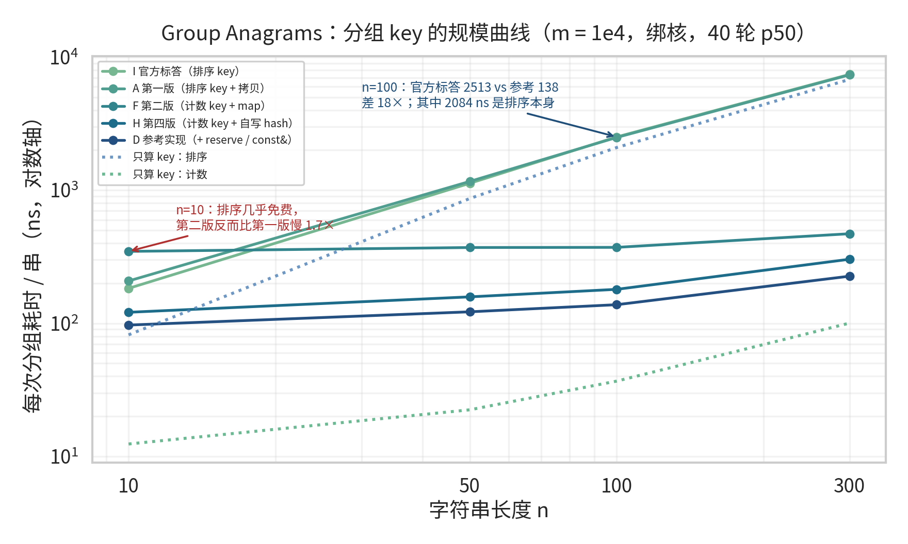
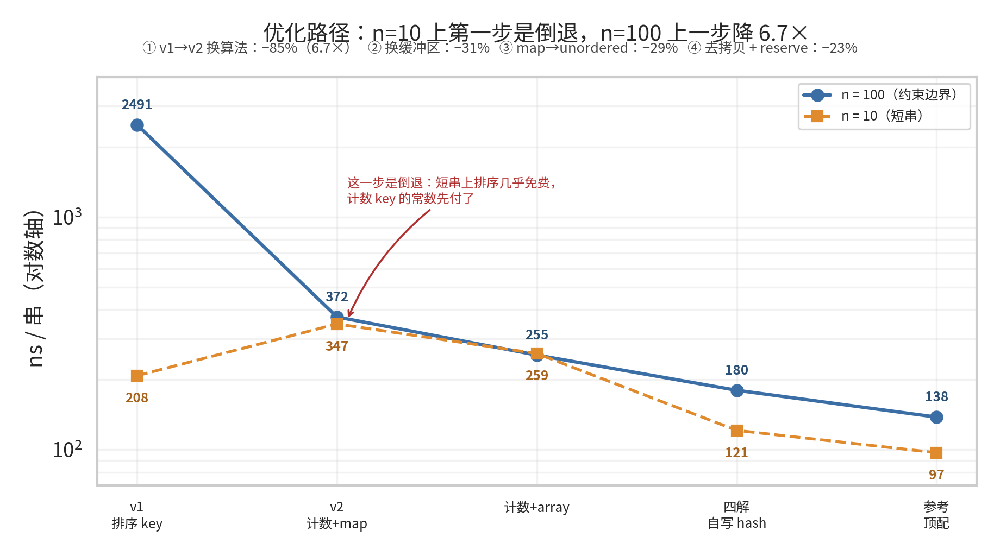
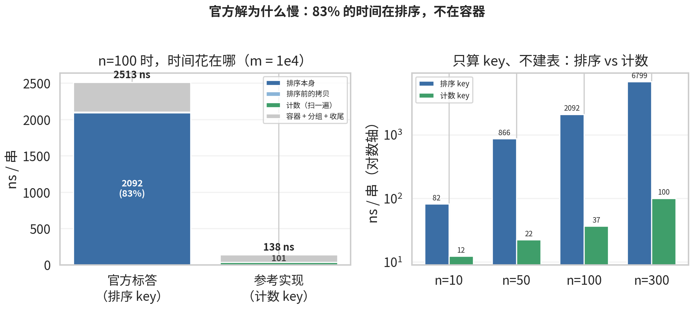

# 附：Group Anagrams 的分组 key —— 排序、计数、map、unordered_map

**起因**：NeetCode 49。题面明写「目标 O(m·n) 时间」，比排序 key 的 O(m·n·log n) 少一个 log。
但同一道题的两版提交，**O(m·n) 的那版在 OJ 上反而慢了 33%**（93 ms → 124 ms），内存还多了 3 MB。
这个实验要回答的就是：那个 log 去哪了，被什么盖住了。

## 一、目的

同一份输入上，把「分组 key 的选法」和「容器的选法」拆开，各自量出代价。
要区分的三件事：**key 怎么算**（排序 vs 计数）、**key 放哪种容器**（红黑树 vs 哈希表）、**数据搬了几次**（引用 / 拷贝 / move）。

## 二、假设（开跑前立的靶子）

1. 计数 key 是 O(m·n)，排序 key 是 O(m·n·log n)，所以计数版应该更快 —— **这条被证伪了**，至少对最初那版实现。
2. log 的收益只在 n 大时显形，n=10 时两者应该差不多 —— **也错了**，短串上差距反而是常数决定的，方向可以是任意的。
3. 官方标答应该是这道题的最优解 —— **错了**，见第五节。

## 三、方法

九种实现，同一份输入、同一台机器、绑核、40 轮取分位数。全部先用 `canonical()` 对拍，确认分组结果一致才计时（`make check`）。

| 记号 | key | 容器 | 备注 |
|---|---|---|---|
| A | 排好序的 `string` | `unordered_map` | 第一版原样，含 `for(auto)` 拷贝 + 结尾整组拷贝 |
| B | 同上 | 同上 | 只把拷贝换成 `const&` / `std::move` |
| C | `array<int,26>` | `map` | 复用一块栈上的计数数组 |
| D | `array<int,26>` | `unordered_map` + 自写 hash | `h = h*131 + x` |
| E | 26 个数字拼成带分隔符的 `string` | `unordered_map` | 分隔符不是可选的，见第六节 |
| F | `vector<int>` | `map` | 第二版原样 |
| G | `array<int,26>` | `map` | 同 F，只把 `vector<int>` 换成 `array` |
| H | `array<int,26>` | `unordered_map` + 自写 hash | 第四版原样（比 D 多了两处拷贝、没 reserve） |
| I | 排好序的 `string` | `unordered_map` | **NeetCode 官方标答，原样照抄** |

另有三组**只算 key、不建表**的对照组，用来把「算 key」和「放容器」拆开；以及每个实现的 **malloc 次数**（单独一遍、不计时）。

## 四、结果



m = 1e4，绑核 `taskset -c 0`，40 轮 p50，单位 **ns/串**：

| | n=10 | n=50 | n=100 | n=300 |
|---|---|---|---|---|
| A 排序key + 拷贝 | 208 | 1164 | 2491 | 7357 |
| B 排序key + move | 143 | 1007 | 2335 | 7196 |
| C 计数key + map | 259 | 238 | 253 | 311 |
| **D 计数key + unordered** | **97** | **122** | **138** | **226** |
| E 计数key + 拼串 | 180 | 206 | 225 | 455 |
| F 第二版（vector + map） | 347 | 371 | 372 | 471 |
| G 第二版换 array | 259 | 246 | 255 | 339 |
| H 第四版（自写 hash） | 121 | 158 | 180 | 303 |
| **I 官方标答** | **183** | **1127** | **2513** | **7410** |

每次调用的 malloc 次数（m=1e4，n=100）：A 110,025 · B 50,002 · C 30,001 · D 30,002 · E 40,004 · F 110,015 · G 30,015 · H 50,025 · **I 70,025**。

原始输出：`results/x86-intel-ultra9-388h/x_group_anagram.txt`。



**三件事**

**1. 「复杂度更低」在 n 小的时候会被常数反向压掉。**
n=10 时第二版（347）比第一版（208）慢 1.7 倍。排序 10 个字符几乎免费，而计数 key 要初始化 26 个桶，
再在一棵红黑树里走十几层、每层比 26 个 `int`。log 那一项还没长出来，常数已经把结果翻过去了。
**但这不说明计数 key 在短串上就该输**：D 在 n=10 是 97，比排序 key 的 208 快 2.1 倍。
同一个算法、换个容器和拷贝方式，结论就反过来了 —— 所以「慢」要归因到具体那一行，不能归因到复杂度。

**2. `map` → `unordered_map` 是最大的一步，比去分配大得多。**
G→D 是 259 → 97（2.7×）；F→G（去掉每串一次 104 字节分配）只是 347 → 259（1.3×）。
一个反直觉的地方：C（复用一块栈上的 array）和 G（每串新开一个 array）几乎一样快——
`array` 在栈上只是移动栈指针，谈不上「分配」。

**3. 排序 key 的成本随 n 涨得很快，但 OJ 看不到。**
n 从 10 涨到 100，A 是 208 → 2491（12×）；D 是 97 → 138（1.4×）。到 n=300，A 已经是 D 的 33 倍。
所以第二版那套写法**不是错的，是提前的**：它在长串区间赢 14 倍，只是 NeetCode 的用例跑不到那里。

## 五、官方解为什么慢

只报「官方解 2513、参考解 138，差 18 倍」是不够的——那是结论，不是原因。把 key 的计算单独拆出来跑（不建表、不插容器）：

| ns/串 | n=10 | n=50 | n=100 | n=300 |
|---|---|---|---|---|
| 排序 key | 81.9 | 866.0 | 2091.9 | 6798.6 |
| ├ 其中：排序前的那次拷贝 | 2.5 | 7.6 | 8.0 | 10.8 |
| 计数 key | 12.4 | 22.4 | 36.8 | 100.4 |



**n=100 时，官方解那 2513 ns 是这样分的：**

| 段 | ns/串 | 占比 |
|---|---|---|
| 排序本身 | 2084 | **83%** |
| 排序前的那次拷贝（必须的，输入是引用） | 8 | 0.3% |
| 建表、分组、最后整组拷贝 | 421 | 17% |

**参考解那 138 ns 是这样分的：**

| 段 | ns/串 | 占比 |
|---|---|---|
| 计数（扫一遍） | 37 | 27% |
| 建表、分组、收尾（含 reserve） | 101 | **73%** |

所以「官方解为什么慢」有两个可分开的答案：

**① 它慢在算 key，不在容器。** 83% 的时间在排序 100 个字符。这是 `n log n` 次字符比较，每一次比较是一个分支；introsort 的分区过程让分支预测器反复失败，实测每次比较摊到约 3 ns。而计数是 n 次自增，线性、无分支、每次不到 0.4 ns。

**② 参考解反过来，73% 花在容器上。** key 只占 27%。所以再想快，方向不是换 key，而是减少分配——`reserve`、避免节点式容器、用开放寻址。**归因不同，下一步就不同**，这是这个拆解真正的用处。

**为什么 n 越大，两边差得越远。** 排序那一侧的代价随 n 增长；计数那一侧是「固定 26 个桶 + n 次自增」，n 变大时增长很慢。容器那一侧同样：`string` key 的哈希和相等比较都要扫 n 个字符，`array<int,26>` 的哈希固定 26 次乘加、相等固定 26 次比较，**与 n 无关**。两条曲线的斜率不同，所以 n=100 时差 18 倍，n=300 时差 33 倍。

**结论**：官方标答的定位是「最短、最不会写错」，不是「最快」——它自己就没满足题面那句「必须优于 O(n log n)」。能说清这个差在哪、为什么差，比写出标答值钱。

## 六、可信度受什么限制

**① OJ 的 Runtime 不是受控实验。** 47 个用例的总耗时打成一个数，用例的规模和分布都不知道，
`Beats 87%` / `Beats 47%` 比的是「常数在这组用例上好不好」，不是「复杂度对不对」。
本实验的 F/A 比值（1.7×，n=10）和 OJ 的（1.33×）方向一致、量级接近，这是两个独立环境的交叉验证——
这种情况下数字才可信。想分清复杂度和常数，只能自己扫 n。

**② 内存涨了不代表结构变差，可能只是 key 变胖了。**
提交的内存 118 MB → 121 MB。`vector<int>(26)` 是 24 字节头 + 104 字节堆块 + 分配器开销 ≈ 130 字节；
而 n=10 的 `string` key 在 SSO（libstdc++ 容量 15）下是内联 32 字节、一次分配都没有。
题面那句「O(m) 空间」只有在 map 里存**下标**时才成立。

**③ 分配次数不等于时间。** A 和 F 的 malloc 次数几乎一样（11 万），但 A 的时间全花在排序、F 全花在树查找。
只数 malloc 会得出「两者一样慢」的错误结论。

**④ 计数 key 拼成字符串必须带分隔符。**
不带的话，「1 个 a + 11 个 b」和「11 个 a + 1 个 b」拼出来都是 `"111000…"`，两个不同的分组会撞在一起。
这是真 bug，不是理论问题——只要字符串长度 ≥ 10 就会发生。

**⑤ 本机是 2 vCPU 虚拟机，不是裸机。** 绝对值比真机偏慢，但同一进程内的**比例**可靠；
跨平台比较要连同 `clock_getres` 和计时器开销一起看。

## 七、怎么跑

```
make            # 编译
make check      # 只对拍正确性
make run        # 绑核跑 25 轮
./bench_anagram 50   # 自定义轮数
```

Windows 上用 MSVC 直接编译 `bench_anagram.cpp`（需要 `-I../common`），
但没有绑核，绝对数字会和 Linux 有差异，比例可比。
出图脚本在 `plot_anagram.py`（matplotlib + seaborn），读的是本文档里的实测数字。
